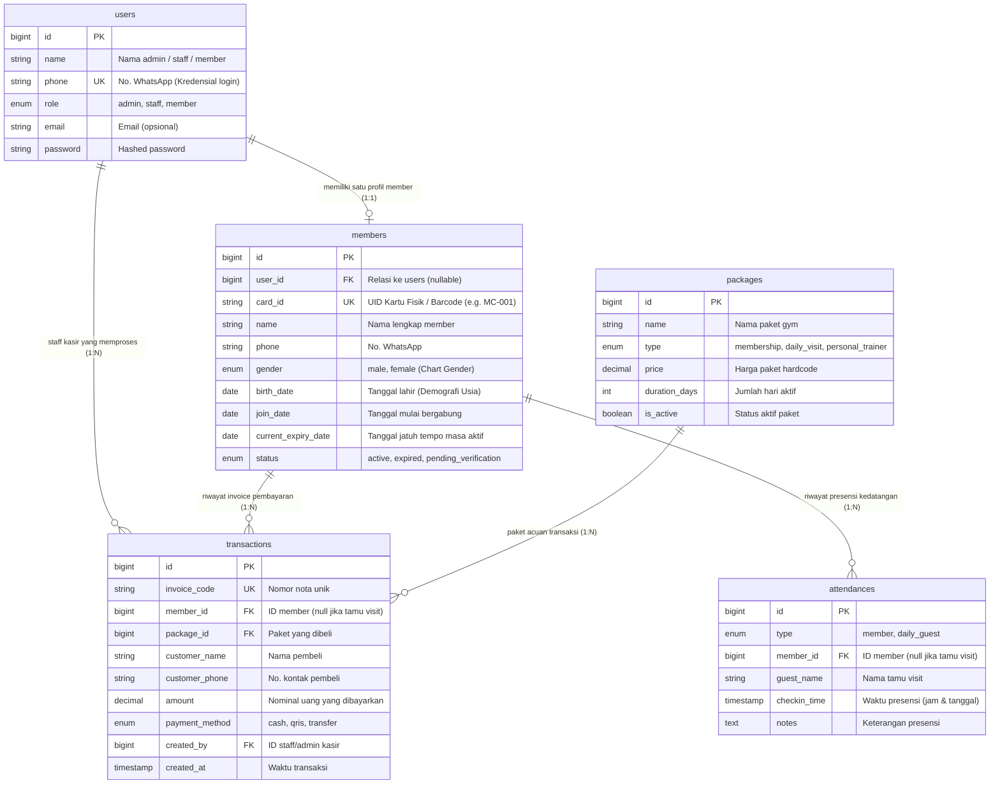

# Dokumentasi Skema & Kebutuhan Database Maco Gym Malang

Dokumen ini merangkum seluruh arsitektur database aplikasi **Maco Gym Malang**, mencakup riwayat perubahan skema (*schema cleanup*), pemetaan relasi antar tabel, kegunaan setiap tabel dan kolom yang dipertahankan, serta sinkronisasi harga paket (*plan*) yang di-hardcode.

---

## 1. Ringkasan Perubahan Skema (*Changelog Restrukturisasi*)

Pembersihan skema dilakukan untuk membuang tabel dan kolom yang tidak pernah digunakan (*dead schema*) di seluruh antarmuka aplikasi (Guest Landing Page, Portal Member, Kasir Frontdesk, dan Admin Dashboard).

### A. Tabel yang Dihapus
1. **`member_routines`**
   - *Alasan*: Aplikasi saat ini tidak menyediakan fitur perancangan atau pencatatan jadwal latihan / menu repetisi harian.
2. **`member_progress`**
   - *Alasan*: Tidak ada form input timbangan berkala atau grafik riwayat lingkar dada/perut di antarmuka profil member maupun admin. Kalkulator BMI pada halaman guest adalah modul kalkulasi interaktif di sisi browser (JavaScript murni).
3. **`trainers`**
   - *Alasan*: Profil 4 pelatih berlisensi (Coach Rangga, Coach Kevin, Coach Maya, Coach Dimas) di halaman landing page bersifat statis dan di-hardcode langsung di Blade (`guest/partials/trainers.blade.php`). Di sisi admin belum ada menu CRUD untuk trainer.

### B. Kolom yang Dihapus pada Tabel `members`
1. `branch` (*varchar*) -> Dihapus karena Maco Gym beroperasi secara terpusat (tidak ada fitur multi-cabang di UI).
2. `target_weight_kg` (*decimal*) -> Dihapus karena tidak ada form input atau tampilan target berat badan.
3. `fitness_goal` (*varchar*) -> Dihapus karena tidak ada fitur pelacakan tujuan kebugaran di antarmuka.

### C. Kolom yang Ditambahkan pada Tabel `members`
1. `birth_date` (*date*, nullable) -> Ditambahkan untuk menyediakan data tanggal lahir member yang sesungguhnya guna memberi suplai data pada **Diagram Batang Demografi Umur** di Dashboard Admin (`< 20 Thn`, `20 - 25 Thn`, `26 - 35 Thn`, `36 - 45 Thn`, `> 45 Thn`).

---

## 2. Diagram Hubungan Entitas (Entity-Relationship Diagram)

---

## 3. Dokumentasi Lengkap Tabel & Kolom yang Dipertahankan

### 1. Tabel `users`
Tabel autentikasi terpusat untuk seluruh pengguna sistem Maco Gym.
- **`id`** (`bigint unsigned`, PK): Identifikator unik akun.
- **`name`** (`varchar(255)`): Nama akun pengguna/pegawai/member.
- **`phone`** (`varchar(255)`, Unique): Nomor WhatsApp aktif yang digunakan sebagai identitas login utama ke aplikasi.
- **`role`** (`enum('admin', 'staff', 'member')`): Menentukan otorisasi rute via `RoleMiddleware`. Admin dan staff diarahkan ke `/admin/dashboard`, sedangkan member diarahkan ke `/member/dashboard`.
- **`email`** (`varchar(255)`, Nullable, Unique): Alamat surel jika dibutuhkan untuk pemberitahuan eksternal.
- **`password`** (`varchar(255)`): Password terenkripsi (Bcrypt). Akun member otomatis dibuat dengan password default `member123` saat didaftarkan di kasir.
- **`remember_token`** (`varchar(100)`, Nullable): Token sesi "Ingat Saya" bawaan Laravel.
- **`created_at` & `updated_at`** (`timestamp`): Waktu pencatatan & modifikasi akun.

---

### 2. Tabel `members`
Tabel profil anggota gym terdaftar. Terhubung secara satu-ke-satu (`1:1`) dengan `users`.
- **`id`** (`bigint unsigned`, PK): Identifikator unik data member.
- **`user_id`** (`bigint unsigned`, Nullable, FK ke `users.id`): Menghubungkan biodata fisik member dengan akun portal login member.
- **`card_id`** (`varchar(255)`, Unique): Kode fisik kartu member (contoh: `MC-001`). Digunakan untuk:
  - Input scan barcode/RFID pada meja Frontdesk kasir.
  - Alternatif input login di form autentikasi.
  - Komponen pembangkit barcode SVG dan QR Code pada kartu digital di dashboard member.
- **`name`** (`varchar(255)`): Nama lengkap member, ditampilkan di portal member, kartu fisik digital, riwayat transaksi, dan meja kasir.
- **`phone`** (`varchar(255)`): Nomor WhatsApp aktif member untuk follow-up perpanjangan masa aktif via tombol WhatsApp 1-klik di panel admin.
- **`gender`** (`enum('male', 'female')`, Nullable): Jenis kelamin member. Digunakan untuk menghitung **Chart Lingkaran Demografi Gender** di Dashboard Admin.
- **`birth_date`** (`date`, Nullable): Tanggal lahir member. Digunakan untuk menghitung usia member pada **Diagram Batang Demografi Umur** di Dashboard Admin.
- **`join_date`** (`date`): Tanggal pertama kali member mendaftar di Maco Gym Malang. Ditampilkan di profil dossier admin dan portal member.
- **`current_expiry_date`** (`date`): Tanggal akhir masa berlaku keanggotaan. Digunakan untuk:
  - Validasi izin masuk di frontdesk (menolak check-in jika kadaluarsa).
  - Menghitung sisa hari aktif (*countdown*).
  - Indikator peringatan jatuh tempo (*H-3 Hampir Habis* atau *Expired*).
- **`status`** (`enum('active', 'expired', 'pending_verification')`): Status keanggotaan.
- **`created_at` & `updated_at`** (`timestamp`): Waktu pendaftaran dan update data.

---

### 3. Tabel `packages` (Katalog Paket Harga Hardcode)
Tabel master acuan paket membership dan tiket harian. Harga paket di-hardcode melalui `PackageSeeder` agar selaras 100% dengan landing page.
- **`id`** (`bigint unsigned`, PK): Identifikator unik paket.
- **`name`** (`varchar(255)`): Nama paket (contoh: *1 Bulan Reguler*, *3 Bulan Hemat*, *1 Bulan Mahasiswa*, *Daily Pass*).
- **`type`** (`enum('membership', 'daily_visit', 'personal_trainer')`): Klasifikasi paket untuk memisahkan opsi pendaftaran/perpanjangan membership dengan penjualan tiket visit harian.
- **`price`** (`decimal(12,2)`): Harga baku paket dalam Rupiah.
- **`duration_days`** (`int`): Jumlah hari masa aktif yang akan ditambahkan ke tanggal jatuh tempo member (`current_expiry_date`).
- **`is_active`** (`tinyint(1)`): Status keterbukaan paket (default `1` / aktif).
- **`created_at` & `updated_at`** (`timestamp`): Waktu pencatatan paket.

---

### 4. Tabel `transactions`
Tabel pencatatan seluruh mutasi penerimaan kas/pembayaran di Maco Gym Malang.
- **`id`** (`bigint unsigned`, PK): Identifikator unik transaksi.
- **`invoice_code`** (`varchar(255)`, Unique): Nomor bukti pembayaran nota (format: `INV-YYYYMMDD-XXXX`).
- **`member_id`** (`bigint unsigned`, Nullable, FK ke `members.id`): Member terkait pembayaran. Bernilai `NULL` apabila transaksi adalah pembelian tiket visit harian non-member.
- **`package_id`** (`bigint unsigned`, FK ke `packages.id`): Paket layanan yang dibeli.
- **`customer_name`** (`varchar(255)`): Nama pembayar (nama member atau nama tamu harian).
- **`customer_phone`** (`varchar(255)`, Nullable): Kontak telepon/WA pembayar.
- **`amount`** (`decimal(12,2)`): Nominal uang masuk. Menghasilkan agregasi finansial di Dashboard Admin:
  - **Pemasukan Hari Ini**
  - **Pemasukan Bulan Ini**
  - **Grafik Omset 6 Bulan Terakhir**
- **`payment_method`** (`enum('cash', 'qris', 'transfer')`): Metode pembayaran yang digunakan.
- **`created_by`** (`bigint unsigned`, FK ke `users.id`): Petugas kasir/staff yang memproses transaksi.
- **`created_at`** (`timestamp`): Tanggal dan waktu pembayaran diselesaikan.

---

### 5. Tabel `attendances`
Tabel riwayat presensi kedatangan pengunjung di meja resepsionis frontdesk.
- **`id`** (`bigint unsigned`, PK): Identifikator unik data presensi.
- **`type`** (`enum('member', 'daily_guest')`): Membedakan presensi member terdaftar atau tamu harian non-member.
- **`member_id`** (`bigint unsigned`, Nullable, FK ke `members.id`): ID member yang hadir (bernilai `NULL` jika tamu harian).
- **`guest_name`** (`varchar(255)`, Nullable): Nama tamu jika tipe adalah `daily_guest`.
- **`checkin_time`** (`timestamp`): Waktu presensi (jam dan menit kedatangan). Digunakan untuk analitik operasional:
  - **Presensi Masuk Hari Ini**
  - **Rata-rata Kehadiran Hari (Senin s/d Minggu)**
  - **Rincian Jam Operasional Sibuk (06:00 s/d 22:00 WIB)**
  - **Penghitung Kunjungan Bulan Ini** di portal member.
- **`notes`** (`text`, Nullable): Catatan presensi (misal: *"Check-in reguler"*, *"Check-in (H-2)"*, *"Tiket Visit Harian"*).

---

## 4. Konfigurasi Paket & Harga Plan Hardcode

Daftar paket resmi yang di-seed ke dalam database dan telah disinkronkan dengan formulir registrasi serta landing page:

| ID | Nama Paket | Tipe | Durasi | Harga Baku | Keterangan di Tampilan |
| :---: | :--- | :--- | :---: | :---: | :--- |
| **1** | **Daily Pass / Visit Harian** | `daily_visit` | 1 Hari | **Rp 25.000** | Tiket masuk gym non-member per kedatangan |
| **2** | **1 Bulan Reguler (Basic Plan)** | `membership` | 30 Hari | **Rp 175.000** | Akses gym unlimited 30 hari penuh |
| **3** | **3 Bulan Hemat (Standard/Popular)** | `membership` | 90 Hari | **Rp 450.000** | Paket terpopuler (hemat Rp 75.000) |
| **4** | **1 Bulan Mahasiswa (Student KTM)** | `membership` | 30 Hari | **Rp 135.000** | Tarif spesial pelajar & mahasiswa Malang |
| **5** | **3 Bulan Mahasiswa (Student Hemat)**| `membership` | 90 Hari | **Rp 360.000** | Tarif hemat mahasiswa Malang |
| **6** | **Personal Trainer 12 Sesi** | `personal_trainer` | 30 Hari | **Rp 1.250.000** | Program pendampingan privat bersama coach |

